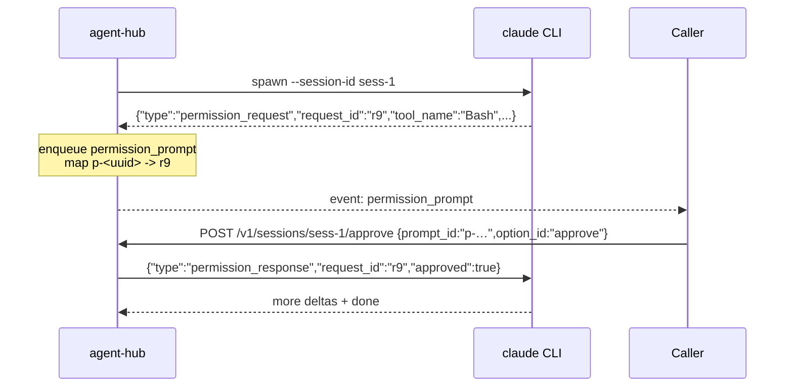

# agent-hub

> Local HTTP service that exposes an OpenAI-compatible SSE surface in front of multiple agents — Claude Code, Codex CLI, OpenClaw, Ollama / vLLM / Hermes. The Even Realities G2 glasses app speaks **one** wire format; the hub is the swap point.

See [`../architecture.md`](../architecture.md) for the full design.

---

## Endpoints

| Method | Path | Purpose |
|---|---|---|
| `GET`  | `/healthz` | Liveness + reports current adapter `kind` |
| `POST` | `/v1/chat/completions` | OpenAI-shaped request. Returns SSE when `stream: true`; returns a single JSON `chat.completion` object when `stream: false` |
| `POST` | `/v1/sessions/:id/approve` | Resolve a `permission_prompt` emitted by a coding-agent adapter |

### Extended SSE events

Standard chat-completions deltas stream as the default SSE event (no `event:` line). Two named events extend the wire:

```
event: agent_status
data: {"kind":"thinking|executing|awaiting_input|done","label":"…"}

event: permission_prompt
data: {"id":"p-…","tool":"Bash","summary":"rm tmp/","options":[{"id":"approve","label":"Approve"},{"id":"deny","label":"Deny"}]}
```

The glasses app's `StreamParser` dispatches on these; OpenAI clients that don't know them simply ignore them.

---

## Run

```bash
npm install
AGENT_KIND=openai DOWNSTREAM_URL=https://api.openai.com DOWNSTREAM_API_KEY=sk-... npm run dev
```

| Env var | Default | What it does |
|---|---|---|
| `HUB_PORT` | `8787` | Bind port |
| `HUB_BIND` | `127.0.0.1` (no token) / `0.0.0.0` (token set) | Interface to bind on. Default is loopback when `HUB_TOKEN` is empty so a misconfigured hub doesn't end up exposed on the LAN. Set `HUB_BIND=0.0.0.0` once a token is configured. |
| `HUB_TOKEN` | *(empty)* | Static bearer token; empty = no static auth + loopback-only by default |
| `AGENT_KIND` | `openai` | **Default** target when a request omits `metadata.agent_kind`. The hub multiplexes all configured targets at once — the glasses switch between `openai`, `local-llm`, `hermes`, `openclaw`, `memory`, `claude-cli`, `codex-cli` per request without a restart. |
| `DOWNSTREAM_URL` | `http://localhost:11434` | Used by `openai` / `local-llm`. Falls back to `CI_LLM_BASE_URL` (trailing `/v1` stripped). |
| `DOWNSTREAM_API_KEY` | *(empty)* | Used by `openai` / `local-llm`. Falls back to `CI_LLM_API_KEY`. |
| `CI_LLM_BASE_URL` | *(unset)* | Canonical CI-Hub inference URL (`${ollama}/v1`); aliased into `DOWNSTREAM_URL`. |
| `CI_LLM_API_KEY` | *(unset)* | Canonical CI-Hub inference key (`ollama`); aliased into `DOWNSTREAM_API_KEY`. |
| `CLAUDE_BIN` | `claude` | Binary spawned by `claude-cli` adapter |
| `CODEX_BIN` | `codex` | Binary spawned by `codex-cli` adapter |
| `OPENCLAW_GATEWAY_URL` | *(empty)* | Endpoint for `openclaw` adapter |
| `OPENCLAW_TOKEN` | *(empty)* | Bearer for the Gateway |
| `AGENT_CWD` | `process.cwd()` | Working directory for coding-agent subprocesses |
| `PORTAL_OIDC_ENABLED` | `false` | When `true`, accept CI-Portal-issued JWTs (verified via JWKS) in addition to `HUB_TOKEN`. |
| `PORTAL_OIDC_ISSUER` | `https://hub.ci.computer` (or `CI_CLOUD_URL`) | Expected `iss` claim. |
| `PORTAL_OIDC_JWKS_URI` | `${issuer}/api/auth/jwks` | JWKS endpoint used to verify EdDSA signatures. |
| `PORTAL_OIDC_AUDIENCE` | `ci-hub,ci-even,ci-server` | Comma-separated allowed `aud` (CI-Portal sets `aud === client_id`). |
| `HERMES_GATEWAY_URL` | *(unset)* | Hermes agent gateway base URL (OpenAI-compatible, e.g. `http://<hub>:8642`). Registers the `hermes` target. |
| `HERMES_APP_SEED` | *(unset)* | Hermes gateway bearer token. |
| `CI_SERVER_URL` | *(unset)* | CI-Server ("Companion Memory") base URL (e.g. `http://<hub>:3030`). Registers the `memory` target. |
| `CI_SERVER_API_KEY` | *(unset)* | Memory-scoped CI-Server API key (sent as `x-api-key`). |
| `CI_SERVER_MEMORY_PATH` | `/memory/recall` | Recall path; `/api/memory/recall` when fronting via the Hub/Traefik proxy. |

---

## Adapters

| Kind | Streams text | Permission prompts | Notes |
|---|---|---|---|
| `openai` | ✅ | ❌ | Forwards to any OpenAI-compatible URL. |
| `local-llm` | ✅ | ❌ | Same shape; convention for Ollama / vLLM on the Hub. |
| `hermes` | ✅ | ❌ | Forwards to the Hermes agent gateway (OpenAI-shaped); token held server-side. |
| `openclaw` | ✅ | ❌ | Forwards to an OpenClaw Gateway; strips code blocks and link clutter for the HUD. |
| `memory` | ✅ | ❌ | Recalls from CI-Server ("Companion Memory") and streams the block back; api-key held server-side. |
| `claude-cli` | ✅ | ✅ | Spawns `claude -p --input-format stream-json --output-format stream-json --session-id <id>`. |
| `codex-cli` | ✅ | ✅ | Spawns `codex --json --session <id>`. |

### How `approve` works (`claude-cli` / `codex-cli`)



The hub never invents an option id — it forwards exactly what the prompt declared. The router validates the session id and that the adapter actually implements `approve`.

---

## Security

- Hub binds on `0.0.0.0` by default but you should **set `HUB_TOKEN`** in any non-localhost deployment.
- Pair with Tailscale (or equivalent) for off-LAN access. Never expose to the public internet without TLS.
- The `claude-cli` / `codex-cli` adapters run the agents with the hub process's permissions. Run the hub as an unprivileged user.

### CI-Portal OIDC (optional)

Set `PORTAL_OIDC_ENABLED=true` to make the hub a CI-Portal **OIDC resource server**: requests may authenticate with a Portal-issued JWT (verified against the Portal JWKS — `iss` + `aud`, EdDSA) instead of the static `HUB_TOKEN`. This matches the platform trust model (Hub-side services validate Portal tokens against the Portal JWKS) and is a direct port of CI-Server's `PortalTokenService`. The glasses app obtains that token via "Sign in with Companion Intelligence". When enabled, the hub requires a valid credential — either a matching `HUB_TOKEN` **or** a valid Portal JWT.

---

## Tests

```bash
npm test
```

The router test exercises the full SSE flow, approval routing, and auth.
