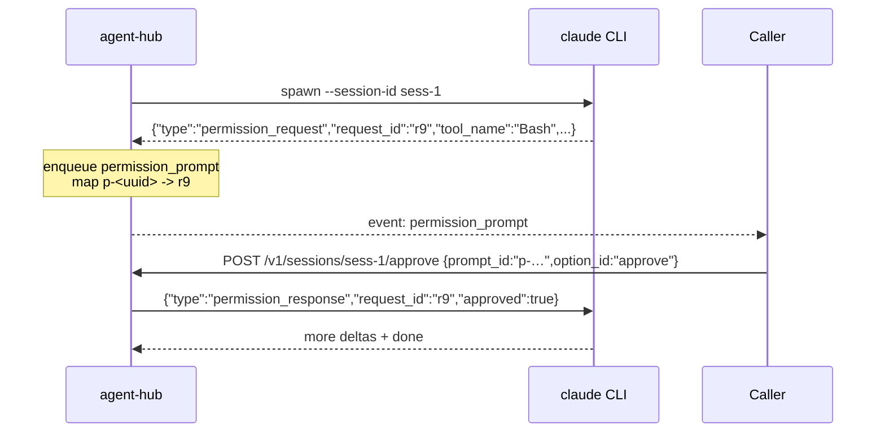

# agent-hub

> Local HTTP service that exposes an OpenAI-compatible SSE surface in front of multiple agents — Claude Code, Codex CLI, OpenClaw, Ollama / vLLM / Hermes. The Even Realities G2 glasses app speaks **one** wire format; the hub is the swap point.

See [`../architecture.md`](../architecture.md) for the full design.

---

## Endpoints

| Method | Path | Purpose |
|---|---|---|
| `GET`  | `/healthz` | Liveness + reports current adapter `kind` |
| `POST` | `/v1/chat/completions` | OpenAI-shaped request, returns SSE with extended `agent_*` events |
| `POST` | `/v1/sessions/:id/approve` | Resolve a `permission_prompt` emitted by a coding-agent adapter |

### Extended SSE events

Standard chat-completions deltas stream as the default SSE event (no `event:` line). Two named events extend the wire:

```
event: agent_status
data: {"kind":"thinking|executing|awaiting_input|done","label":"…"}

event: permission_prompt
data: {"id":"p-…","tool":"Bash","summary":"rm tmp/","options":[{"id":"approve","label":"Approve"},{"id":"deny","label":"Deny"}]}
```

The glasses app's `StreamParser` dispatches on these; OpenAI clients that don't know them simply ignore them.

---

## Run

```bash
npm install
AGENT_KIND=openai DOWNSTREAM_URL=https://api.openai.com DOWNSTREAM_API_KEY=sk-... npm run dev
```

| Env var | Default | What it does |
|---|---|---|
| `HUB_PORT` | `8787` | Bind port |
| `HUB_TOKEN` | *(empty)* | Required bearer token; empty = no auth (dev only) |
| `AGENT_KIND` | `openai` | One of `openai`, `local-llm`, `claude-cli`, `codex-cli`, `openclaw` |
| `DOWNSTREAM_URL` | `http://localhost:11434` | Used by `openai` / `local-llm` |
| `DOWNSTREAM_API_KEY` | *(empty)* | Used by `openai` / `local-llm` |
| `CLAUDE_BIN` | `claude` | Binary spawned by `claude-cli` adapter |
| `CODEX_BIN` | `codex` | Binary spawned by `codex-cli` adapter |
| `OPENCLAW_GATEWAY_URL` | *(empty)* | Endpoint for `openclaw` adapter |
| `OPENCLAW_TOKEN` | *(empty)* | Bearer for the Gateway |
| `AGENT_CWD` | `process.cwd()` | Working directory for coding-agent subprocesses |

---

## Adapters

| Kind | Streams text | Permission prompts | Notes |
|---|---|---|---|
| `openai` | ✅ | ❌ | Forwards to any OpenAI-compatible URL. |
| `local-llm` | ✅ | ❌ | Same shape; convention for Ollama / vLLM / Hermes. |
| `claude-cli` | ✅ | ✅ | Spawns `claude -p --input-format stream-json --output-format stream-json --session-id <id>`. |
| `codex-cli` | ✅ | ✅ | Spawns `codex --json --session <id>`. |
| `openclaw` | ✅ | ❌ | Forwards to an OpenClaw Gateway; strips code blocks and link clutter for the HUD. |

### How `approve` works (`claude-cli` / `codex-cli`)



The hub never invents an option id — it forwards exactly what the prompt declared. The router validates the session id and that the adapter actually implements `approve`.

---

## Security

- Hub binds on `0.0.0.0` by default but you should **set `HUB_TOKEN`** in any non-localhost deployment.
- Pair with Tailscale (or equivalent) for off-LAN access. Never expose to the public internet without TLS.
- The `claude-cli` / `codex-cli` adapters run the agents with the hub process's permissions. Run the hub as an unprivileged user.

---

## Tests

```bash
npm test
```

The router test exercises the full SSE flow, approval routing, and auth.
