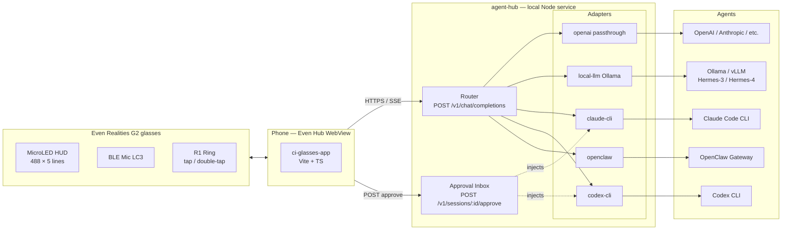
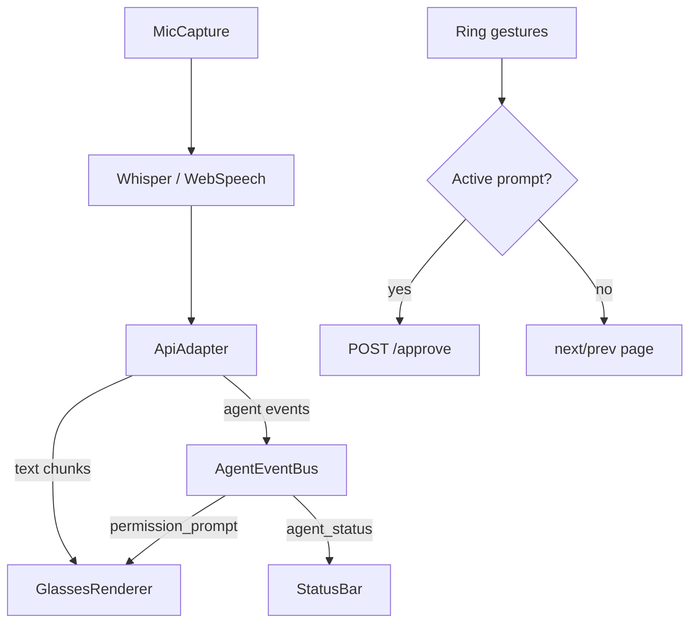
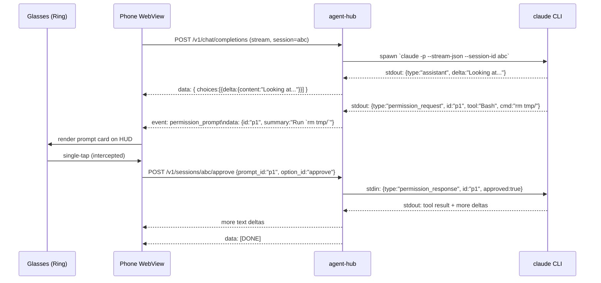

# Architecture — CI Glasses + Agent Hub

> Pluggable local-agent platform for Even Realities G2 (and any OpenAI-compatible smart-glasses client). One glasses app, one wire contract, many agents — Hermes / OpenClaw / Claude Code / Codex behind one stable SSE surface.

---

## 1. Goals

| Goal | Why it matters |
|---|---|
| Glasses app stays dumb (OpenAI SSE client) | One codebase, no agent-specific glue on the device |
| All agent integration lives in **one local hub** | Single process to install, one place to add a new agent |
| Drop-in for existing backends | Today's settings keep working — `openai` kind = pass-through |
| First-class permission prompts | Coding agents only become useful from glasses if you can **approve** from the ring |
| Local-first | Ollama / llama.cpp Hermes models route locally; no Cloudflare/cloud required |

---

## 2. System overview



The phone never speaks any protocol other than OpenAI SSE + a small JSON approval POST. Everything agent-specific is in `agent-hub/`.

---

## 3. Wire contract (glasses ↔ hub)

### 3.1 Request

```
POST /v1/chat/completions
Authorization: Bearer <token>
Content-Type: application/json

{
  "model": "ci-companion",
  "stream": true,
  "messages": [
    { "role": "system",    "content": "..." },
    { "role": "user",      "content": "..." }
  ],
  "metadata": {
    "session_id": "uuid-or-null",
    "agent_kind": "claude-cli"   // optional, hub may force from env
  }
}
```

### 3.2 Response — extended SSE

Standard OpenAI deltas are emitted unchanged. The hub adds **two custom event types** so the glasses can render structured agent activity without breaking compatibility with other OpenAI clients (which ignore unknown events).

| `event:` | `data:` shape | Glasses behaviour |
|---|---|---|
| *(default)* | `{ choices: [{ delta: { content: "..." } }] }` | Append to streaming text |
| `agent_status` | `{ kind: "thinking"\|"executing"\|"awaiting_input"\|"done", label?: string }` | Update HUD status line |
| `permission_prompt` | `{ id, tool, summary, options: [{ id, label }] }` | Render prompt card, intercept next tap |
| `[DONE]` | — | Close stream |

### 3.3 Approval POST

```
POST /v1/sessions/:session_id/approve
{ "prompt_id": "...", "option_id": "approve" | "deny", "comment": "optional" }
```

Hub looks up the in-flight agent process by `session_id` and writes the chosen option to its stdin (claude-cli/codex-cli) or POSTs back to the Gateway (openclaw).

---

## 4. Glasses app (`ci-glasses-app`) — what changes



| File | Change |
|---|---|
| `src/config/Settings.ts` | New field `backendKind: BackendKind` |
| `src/ui/SettingsView.ts` | New "Backend Kind" selector |
| `src/ai/StreamParser.ts` | Parse `event: agent_status` / `event: permission_prompt` |
| `src/ai/ApiAdapter.ts` | Emit `AgentEvent`s alongside text via a separate generator |
| `src/glasses/GlassesRenderer.ts` | New `displayPromptCard()` method |
| `src/Main.ts` | Track active prompt; single-tap routes to approve when present |

Backwards compat: when the hub is in `openai` pass-through kind, no custom events appear and behaviour is identical to today.

---

## 5. Agent hub (`agent-hub/`) — new package

### 5.1 Layout

```
agent-hub/
├── package.json
├── tsconfig.json
├── src/
│   ├── server.ts                # HTTP entry — Bun or Node
│   ├── router.ts                # /v1/chat/completions + /v1/sessions/...
│   ├── sse.ts                   # SSE writer helpers
│   ├── sessions.ts              # session_id -> adapter handle map
│   ├── adapters/
│   │   ├── Adapter.ts           # interface: run(req, ctx) -> AsyncIterable<AgentEvent>
│   │   ├── passthrough.ts       # forwards to a downstream OpenAI-compatible URL
│   │   ├── ollama.ts            # local-llm; same shape, configurable host
│   │   ├── claudeCli.ts         # spawns `claude -p --input-format stream-json ...`
│   │   ├── codexCli.ts          # spawns `codex --json` (or equivalent)
│   │   └── openclaw.ts          # POSTs to OpenClaw Gateway + content stripping
│   └── events.ts                # AgentEvent type + helpers
└── README.md
```

### 5.2 Adapter contract

```ts
export interface Adapter {
  kind: BackendKind;
  run(req: ChatRequest, ctx: SessionContext): AsyncIterable<AgentEvent>;
  /** Optional — for adapters that own an interactive process. */
  approve?(promptId: string, optionId: string): Promise<void>;
}

export type AgentEvent =
  | { type: 'text';              delta: string }
  | { type: 'agent_status';      kind: 'thinking'|'executing'|'awaiting_input'|'done'; label?: string }
  | { type: 'permission_prompt'; id: string; tool: string; summary: string; options: PromptOption[] }
  | { type: 'error';             message: string };
```

### 5.3 Sequence: Claude Code permission prompt → ring approval



---

## 6. Backend kinds — capability matrix

| Kind | Where it runs | Auth | Streams text | Tool calls | Permission prompts | Notes |
|---|---|---|---|---|---|---|
| `openai` | Any OpenAI-compat URL | Bearer | ✅ | passthrough | ❌ | Today's default. Hub may be skipped entirely. |
| `local-llm` | Ollama / vLLM / llama.cpp on LAN | none/Bearer | ✅ | model-dependent | ❌ | Hermes-3 / Hermes-4 GGUF lands here. |
| `claude-cli` | Mac/PC with Claude Code installed | Claude Pro/Max sub | ✅ | ✅ | ✅ | Spawns `claude -p` headless. |
| `codex-cli` | Mac/PC with Codex CLI installed | OpenAI sub | ✅ | ✅ | ✅ | Same pattern, different binary. |
| `openclaw` | OpenClaw Gateway (local or hosted) | Gateway token | ✅ | ✅ | partial | Ported from dAAAb's Worker. |

---

## 7. Security model

| Concern | Mitigation |
|---|---|
| Hub exposed on LAN | Bearer token + bind to LAN interface only by default; Tailscale recommended for remote use |
| Permission spoofing | `prompt_id` is hub-generated nonce; mapped to a specific session+process; one-shot consumption |
| Command injection via approve | `option_id` validated against the prompt's declared options; never substituted into shell |
| Stdin/stdout corruption | Adapters parse stream-json line-by-line with framing guards; bad lines logged & skipped |
| Audio leakage | Audio never leaves the hub unless the configured STT adapter explicitly forwards it |

---

## 8. Out of scope (initial cut)

- Mira AI glasses port — no public SDK as of May 2026; revisit when one ships.
- Hub-side conversation persistence beyond in-memory session map. (Claude/Codex CLIs persist their own sessions.)
- Multi-user hub. Hub assumes a single trusted user on LAN.
- Tool result truncation/summarisation policies. Adapters pass results through; the renderer truncates for display only.

---

## 9. Open questions

- [ ] Final SSE event names — `agent_status` vs `status`? Lean on `agent_*` prefix to avoid collisions.
- [ ] Should `local-llm` and `openai` collapse into one adapter parameterised by URL? Probably yes after first cut.
- [ ] Codex CLI JSON event shape — confirm against current Codex release; may need a parser tweak.
- [ ] Should the hub multiplex multiple G2s (per-device session_id) or stay single-user? Single-user for v1.
