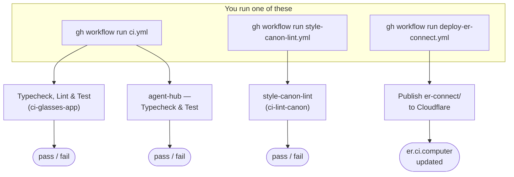

# CI pipeline reference

What each GitHub Actions workflow in this repo does, and the exact commands
to run one from a terminal. This file is **hand-maintained** and safe to
edit — unlike [`docs/CI.md`](CI.md), which is generated by the org's
`ci-local` tool and says so at the top ("This file is generated - do not
hand-edit"). Read `docs/CI.md` first for the *why* (the org disabled
automatic push/PR triggers repo-wide to cut GitHub Actions hosted-runner
cost — see that file for the numbers); this file is the *what* and *how*,
kept current by hand alongside the workflows themselves.

## Why every workflow needs a manual dispatch

All three workflows below trigger on `workflow_dispatch` only. None of them
run automatically on `git push` or on opening a pull request. If you just
pushed a commit or opened a PR and don't see a check appear, that's
expected — dispatch it yourself with one of the commands below.

## The three workflows



| Workflow file | Jobs | What it checks / does | Needs |
|---|---|---|---|
| `ci.yml` | `ci` (ci-glasses-app), `agent-hub` | `npm run typecheck`, `npm run lint` (ci-glasses-app only), `npm test` for both packages | `ci-glasses-app`'s job needs `NODE_AUTH_TOKEN` (uses the workflow's own `secrets.GITHUB_TOKEN`) to install the private `@companionintelligence/*` packages from `npm.pkg.github.com`. `agent-hub` has no private deps and needs nothing extra. |
| `style-canon-lint.yml` | `style-canon-lint` | Runs `ci-lint-canon` (from `@companionintelligence/config`) against `ci-glasses-app` to check the CI-Common design-token canon is followed | Same `NODE_AUTH_TOKEN` requirement as `ci.yml`, for the same reason. |
| `deploy-er-connect.yml` | `deploy` | Publishes `er-connect/` via plain `wrangler deploy` — it's a Cloudflare Worker with static assets (config in `er-connect/wrangler.jsonc`), not a classic Pages project; `wrangler pages deploy` doesn't work against it | `CLOUDFLARE_API_TOKEN` and `CLOUDFLARE_ACCOUNT_ID` repo secrets — **not yet configured** as of this writing, so this workflow can't redeploy yet even though the site itself is already live at `er.ci.computer` (deployed locally). See [`er-connect/README.md`](../er-connect/README.md). |

## Commands (macOS)

Install the GitHub CLI once if you don't have it:

```bash
brew install gh
gh auth login
```

Then, from anywhere (no need to `cd` into the repo first):

```bash
# Run the main typecheck/lint/test suite (both packages)
gh workflow run ci.yml --repo companionintelligence/CI-Even-Realities --ref main

# Run the design-token canon lint
gh workflow run style-canon-lint.yml --repo companionintelligence/CI-Even-Realities --ref main

# Deploy er-connect to Cloudflare (needs the repo secrets above first)
gh workflow run deploy-er-connect.yml --repo companionintelligence/CI-Even-Realities --ref main
```

`--ref` matters: a workflow file only dispatchable on the branch it exists
on, so point `--ref` at your feature branch if the workflow (or your fix to
it) hasn't landed on `main` yet.

Watch a run after dispatching it:

```bash
gh run watch --repo companionintelligence/CI-Even-Realities
```

## Running the same checks locally, without CI at all

Since CI doesn't run automatically, it's worth running these yourself before
pushing:

```bash
# ci-glasses-app (needs NODE_AUTH_TOKEN — a GitHub PAT with read:packages —
# to install the private @companionintelligence/* packages)
cd ci-glasses-app
NODE_AUTH_TOKEN=<your-github-pat> npm install
npm run typecheck && npm run lint && npm test

# agent-hub (no private deps, no token needed)
cd ../agent-hub
npm install
npm run typecheck && npm test
```

## Related docs

- [`docs/CI.md`](CI.md) — the generated runbook: why triggers are gated, and the canonical dispatch commands (regenerate with `ci-local docs`, from the org's `CI-Local-CICD` tooling — not part of this repo).
- [`er-connect/README.md`](../er-connect/README.md) — deploy details (it's a Cloudflare Worker, not Pages) for `deploy-er-connect.yml`'s target.
- [`CHANGELOG.md`](../CHANGELOG.md) — when each workflow/job was added.
