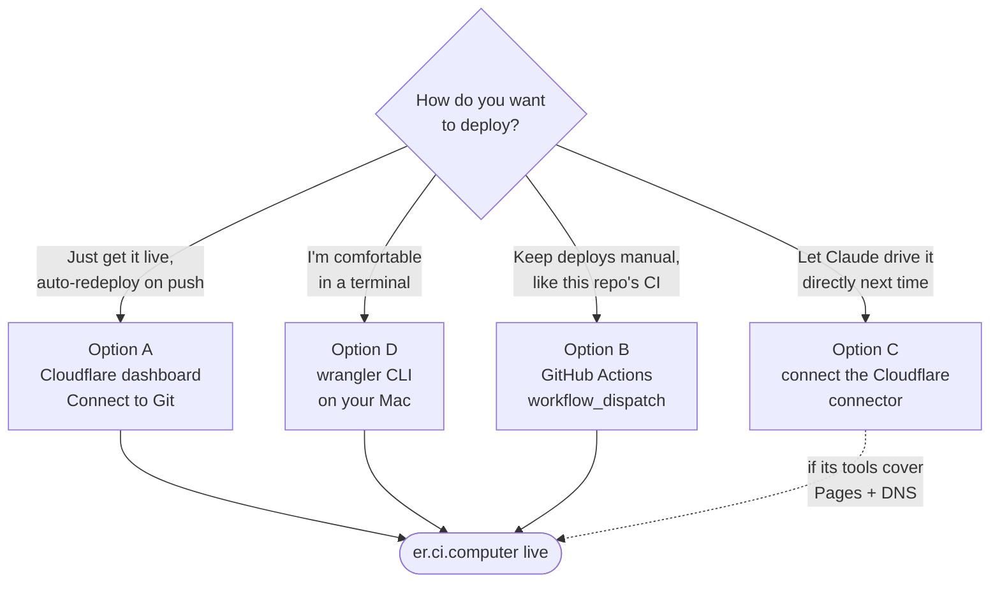

# er-connect

The public "Setup & Connect" page for **CI Companion**, meant to be served at
**er.ci.computer**. Plain static HTML/CSS/JS — no build step, no framework,
no dependency on the private `@companionintelligence/*` packages (the canon
color tokens are hardcoded from `ci-glasses-app/src/ui/styles.css`, since this
site has no npm install step of its own). Includes a client-side "Quick
Connect" config generator (mirrors `ci-glasses-app/src/config/HubPresets.ts`)
and a Mermaid "how it works" diagram — no network calls beyond loading fonts
and the Mermaid script; nothing you type leaves the visitor's browser.


## Preview locally

```bash
npx serve er-connect
# or just open er-connect/index.html directly in a browser
```

## Deploy — no Claude session has Cloudflare credentials, so this needs a human

Neither this repo's CI nor any Claude session working in it currently has
Cloudflare access (no API token, no connected connector). Someone with access
to the Cloudflare account that owns the `ci.computer` zone needs to do a
**one-time** setup. Pick one:




### Option A — Cloudflare's own Git integration (simplest, recommended)

No GitHub secrets, no CLI. Cloudflare builds and deploys straight from the
repo on every push.

1. Go to the [Cloudflare dashboard](https://dash.cloudflare.com/) → **Workers
   & Pages** → **Create** → **Pages** → **Connect to Git**.
2. Authorize/select the `companionintelligence/CI-Even-Realities` GitHub repo.
3. Build settings:
   - **Production branch**: `main`
   - **Build command**: *(leave empty — it's static)*
   - **Build output directory**: `er-connect`
4. Click **Save and Deploy**. Cloudflare gives the project a URL like
   `ci-er-connect.pages.dev` — confirm the page loads there first.
5. Open the project → **Custom domains** → **Set up a custom domain** →
   enter `er.ci.computer` → follow the prompt. Cloudflare adds the DNS
   record to the `ci.computer` zone automatically (the zone must already be
   on this same Cloudflare account).

Done — `er.ci.computer` goes live, and every future push to `main` that
touches `er-connect/` redeploys it automatically.

### Option B — the GitHub Actions workflow already in this repo

Use this instead if you'd rather keep deploys manually triggered, consistent
with this repo's [CI cost-gating policy](../docs/CI.md) (Option A auto-deploys
on every push; this one only runs when dispatched).

1. **Repo secrets** (repo Settings → Secrets and variables → Actions):
   - `CLOUDFLARE_API_TOKEN` — create at My Profile → API Tokens → **Create
     Token** → "Edit Cloudflare Workers" template (or a custom token with
     `Account.Cloudflare Pages: Edit`), scoped to the account that owns
     `ci.computer`.
   - `CLOUDFLARE_ACCOUNT_ID` — Cloudflare dashboard → Workers & Pages →
     Overview → right sidebar.
2. Run the workflow once:
   ```bash
   gh workflow run deploy-er-connect.yml --repo companionintelligence/CI-Even-Realities --ref main
   ```
   `wrangler pages deploy` creates the `ci-er-connect` Pages project
   automatically on first run.
3. **Custom domain** — same dashboard step as Option A #5 above (this part
   can't be scripted from CI either way — it's always a one-time dashboard
   action, or `wrangler pages domain add er.ci.computer --project-name=ci-er-connect`
   for whoever holds the account credentials).

### Option D — wrangler CLI from your Mac (no dashboard clicking at all)

Same end result as Option A, entirely from Terminal. Needs Node.js (`brew
install node` if you don't have it) and a Cloudflare account with access to
the `ci.computer` zone.

```bash
# 1. Install Cloudflare's CLI
npm install -g wrangler

# 2. Log in (opens a browser tab once, then remembers you)
wrangler login

# 3. Get the repo, if you don't already have it locally
git clone https://github.com/companionintelligence/CI-Even-Realities.git
cd CI-Even-Realities

# 4. Create the Pages project (one-time)
wrangler pages project create ci-er-connect --production-branch=main

# 5. Deploy the site
wrangler pages deploy er-connect --project-name=ci-er-connect

# 6. Attach the custom domain (one-time; the ci.computer zone must already
#    be on this Cloudflare account)
wrangler pages domain add er.ci.computer --project-name=ci-er-connect
```

`er.ci.computer` is live after step 6. To push a future update by hand, `cd`
into the repo, `git pull`, and re-run step 5 — that's the whole redeploy.

### Option C — give a future Claude session Cloudflare access

This Claude Code org has a **"Cloudflare Developer Platform"** connector
available (not yet connected). Connecting it at
[claude.ai/customize/connectors](https://claude.ai/customize/connectors) and
starting a new session would let Claude call the Cloudflare API directly —
worth trying, though its tool surface leans toward Workers/KV and it isn't
confirmed to cover Pages deploys or DNS zone management. If it doesn't, fall
back to Option A or B.

## Files

- `index.html` — the whole page: content, inline styles, the "how it works" Mermaid diagram, the Quick Connect generator, and a copy-to-clipboard helper.
- `assets/` — app icon (from `ci-glasses-app/assets/icons/`), the Chat/Settings screenshots (from `docs/ui/`, the same current-brand captures the main README uses), and `preview.png` (a fresh full-viewport capture of this page, for this README).
- `_headers` — Cloudflare Pages security headers (CSP, frame/referrer policy; `script-src` allows `cdn.jsdelivr.net` for the Mermaid library).
