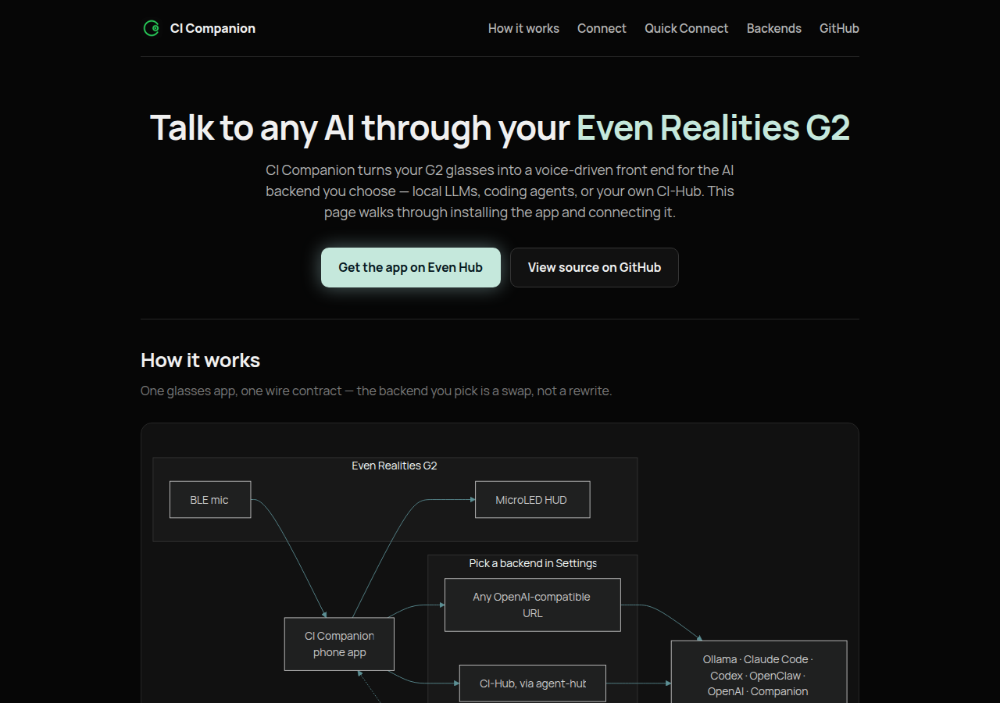

# er-connect

The public "Setup & Connect" page for **CI Companion**, meant to be served at
**er.ci.computer**. Plain static HTML/CSS/JS — no build step, no framework,
no dependency on the private `@companionintelligence/*` packages (the canon
color tokens are hardcoded from `ci-glasses-app/src/ui/styles.css`, since this
site has no npm install step of its own). Includes a client-side "Quick
Connect" config generator (mirrors `ci-glasses-app/src/config/HubPresets.ts`),
a Mermaid "how it works" diagram, and a "Sign in with Companion Intelligence"
flow (mirrors `ci-glasses-app/src/auth/OidcClient.ts`) that remembers your Hub
host and reconnects automatically on your next visit.



## Sign in & auto-connect

The Quick Connect section (`#quick-connect`) has a "Sign in with Companion
Intelligence" button that runs a real Authorization Code + PKCE flow against
CI-Portal (`https://hub.ci.computer/api/auth`). Nothing but the OIDC exchange
and the Hub-reachability check ever leaves the browser.

Once you've signed in and entered a Hub host, both are remembered in
`localStorage` — reload the page and it signs you back in and reconnects with
no clicks. Sign-in is optional: the Quick Connect generator below it works
without ever signing in.

### Prerequisite: register the OIDC client

`app.js` uses `client_id: 'ci-er-connect'`. CI-Portal's `PUBLIC_CLIENTS`
registry must have an entry for it with `redirect_uri` set to this page's
deployed URL (e.g. `https://er.ci.computer/`) — that's a CI-Portal-side
change, not something this repo can do on its own. Until it's registered,
sign-in will fail at the authorize step with an invalid-client error from the
IdP.

## Preview locally

```bash
npx serve er-connect
# or just open er-connect/index.html directly in a browser
```

## Deploy

**Live** at <https://er.ci.computer>, deployed as a **Cloudflare Worker with
static assets** — not a classic Cloudflare Pages project, and that wasn't a
choice, it's what `wrangler` (4.143.0, as of this writing) does by default
now. `wrangler pages project create ci-er-connect` produced a Worker (with
`assets.directory` set) rather than an entry in `wrangler pages project
list`; the CLI itself says so — "Workers are the recommended way to deploy
all new projects" — and even offers a `--force` flag to opt back into a
classic Pages project, which we did not use. Once that happens,
`wrangler pages deploy` no longer works against it (`The Pages project
"ci-er-connect" does not exist`) — everything below uses plain `wrangler
deploy`, which reads the Worker name, assets directory, and the
`er.ci.computer` custom-domain route straight from `wrangler.jsonc` in this
directory, rather than from CLI flags.

Worth knowing: the rest of `ci.computer`'s sites (`ci-virtual-home`,
`time-machine`, `ci-os-hub-docs`, `ci-pebble`, `avatars`,
`ci-public-website`, `spellbook` — checked via `wrangler pages project
list` against this same account) are all still classic Pages projects on
`*.pages.dev` with dashboard-managed custom domains. This site is the
current outlier, forced by what the CLI does today rather than chosen for
consistency with its siblings. Someone with dashboard access might want to
confirm whether **Workers & Pages → Create → Pages → Connect to Git** still
creates a classic Pages project for a *brand-new* site today, or already
defaults to the same Workers-based flow this CLI path landed on — if it's
the latter, the *rest* of those sites are the ones that'll look like
outliers on their next redeploy, not this one.

### Redeploy

```bash
cd er-connect
npx wrangler deploy
```

Needs a Cloudflare account with access to `ci.computer` — run `npx wrangler
login` first if not already authenticated (opens a browser tab once).
`wrangler.jsonc` already declares everything (Worker name, `.` as the
assets directory, the `er.ci.computer` route), so this one command is the
whole redeploy.

### Or via GitHub Actions

[`deploy-er-connect.yml`](../.github/workflows/deploy-er-connect.yml) runs
the same `wrangler deploy` from CI, manually triggered:

```bash
gh workflow run deploy-er-connect.yml --repo companionintelligence/CI-Even-Realities --ref main
```

Needs `CLOUDFLARE_API_TOKEN` and `CLOUDFLARE_ACCOUNT_ID` set as repo secrets
(Settings → Secrets and variables → Actions): the token from My Profile →
API Tokens → **Create Token** → "Edit Cloudflare Workers" template, scoped
to the account that owns `ci.computer`; the account ID from the dashboard
sidebar under Workers & Pages → Overview.

### Give a future Claude session Cloudflare access instead

This Claude Code org has a **"Cloudflare Developer Platform"** connector
available. Connecting it at
[claude.ai/customize/connectors](https://claude.ai/customize/connectors) and
starting a new session would let Claude run `wrangler deploy` (or call the
API directly) without a human in the loop for future redeploys.

## Files

- `index.html` — the whole page: content, inline styles, the "how it works" Mermaid diagram, the Quick Connect generator, and the sign-in UI.
- `app.js` — page chrome (Mermaid render, copy buttons, Quick Connect generator) plus the CI-Portal PKCE sign-in flow and Hub-reachability probe.
- `assets/` — app icon (from `ci-glasses-app/assets/icons/`), the Chat/Settings screenshots (from `docs/ui/`, the same current-brand captures the main README uses), and `preview.png` (a fresh full-viewport capture of this page, for this README).
- `_headers` — security headers (CSP, frame/referrer policy; `script-src` allows `cdn.jsdelivr.net` for the Mermaid library, `connect-src` is open since the Hub host and CI-Portal are both cross-origin and user/environment-dependent). Still honored under Workers static assets — verified against the live deploy.
- `wrangler.jsonc` — the Worker config: name (`ci-er-connect`), static-assets directory (`.`), and the `er.ci.computer` custom-domain route. `wrangler deploy` reads everything from here; see Deploy above.
