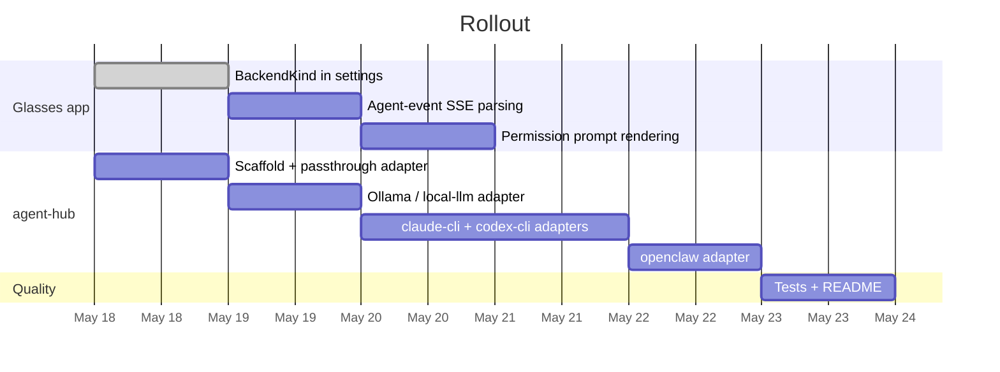
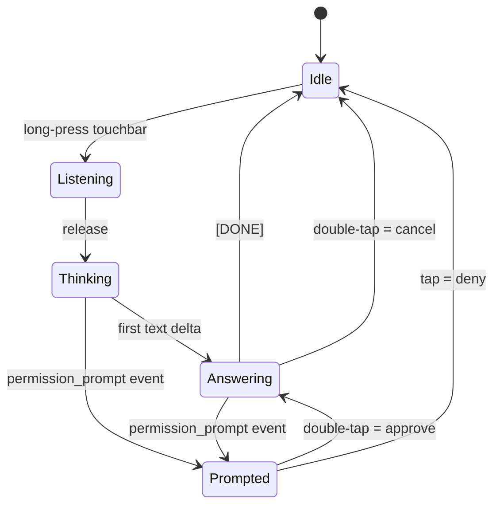

# Planning — Pluggable Local-Agent Support

Tracking doc for the refactor that lets the CI Glasses app drive **any local agent** (Hermes via Ollama, OpenClaw, Claude Code, Codex) through a single OpenAI-shaped wire. See [architecture.md](architecture.md) for the deeper design.

---

## TL;DR

- Add `BackendKind` to settings → glasses app stays a thin OpenAI client.
- Introduce **two custom SSE events** (`agent_status`, `permission_prompt`) so coding agents can drive the HUD.
- Wire the ring to an **approve** endpoint when a prompt is pending (as built: double-tap approves, single tap denies).
- Ship a new `agent-hub/` Node service with five adapters covering every agent on the roadmap.

---

## Milestones

---

## Workstreams + checkboxes

### A — Glasses app refactor

- [x] Add `BackendKind` (`openai | local-llm | claude-cli | codex-cli | openclaw`) to `BackendConfig`
- [x] Surface a "Backend Kind" selector in `SettingsView`
- [x] Extend `StreamParser` to surface SSE `event:` lines (not just `data:`) and yield structured `AgentEvent`s
- [x] Add an `AgentEvent` union + emit it through `ApiAdapter.sendMessage` alongside text
- [x] `GlassesRenderer.displayPromptCard({summary, options})` — renders Approve / Deny on the HUD
- [x] `Main.ts` — when a prompt is active, double-tap = approve, single-tap = deny (a deliberate gesture approves; an accidental brush must never)
- [x] Backwards compat: behaviour unchanged when no custom events are present
- [ ] Manual smoke against a real G2 (deferred to user; not part of this branch)

### B — `agent-hub/` package

- [x] Scaffold Node + TS project (`package.json`, `tsconfig.json`, `src/server.ts`)
- [x] `Adapter` interface + `AgentEvent` types + SSE writer helpers
- [x] Sessions map (in-memory) keyed by `session_id`
- [x] `POST /v1/chat/completions` router that dispatches to the configured adapter
- [x] `POST /v1/sessions/:id/approve` endpoint
- [x] Adapter: `passthrough` (any OpenAI-compatible URL)
- [x] Adapter: `local-llm` (Ollama / vLLM — same shape, configurable host)
- [x] Adapter: `claude-cli` (spawns `claude -p --input-format stream-json --output-format stream-json`)
- [x] Adapter: `codex-cli` (spawns Codex with JSON streaming)
- [x] Adapter: `openclaw` (Node port of dAAAb's bridge; G2 content stripping)
- [x] Health endpoint + structured logs with request-id propagation
- [ ] Multi-G2 multiplexing — left for v2

### C — Quality + docs

- [x] Vitest coverage for new `StreamParser` event-line parsing
- [x] Vitest coverage for the hub router happy path
- [x] Vitest integration test: fake downstream → hub → glasses-shaped SSE
- [x] Live end-to-end against Ollama (`qwen2.5:0.5b` via `local-llm` adapter) — 1.4 s round-trip
- [x] Update repo `README.md` to point at the hub and document the new backend kinds
- [x] Update `notes/even-realities-resources.md` with the upstream projects this work draws on

### D — Even Hub publish prep

- [x] `app.json` migrated to current portal schema (edition `202601`, valid permission names, valid `package_id`)
- [x] Add `@evenrealities/evenhub-cli` as devDependency + `pack:ehpk` / `qr` npm scripts
- [x] Produce `ci-companion.ehpk` (35 KB) — verified by `evenhub pack`
- [x] `PUBLISHING.md` covering pre-flight checklist, manifest reference, dev-mode QR flow, store listing copy, versioning, rollback
- [x] `*.ehpk` added to `.gitignore`
- [ ] Manual `evenhub login` + portal upload — needs human credentials

---

## Risks + mitigations

| Risk | Likelihood | Mitigation |
|---|---|---|
| Claude / Codex CLI stream-json shape drifts | Medium | Isolated in one adapter file; one place to patch |
| BLE throughput spikes when prompts arrive mid-stream | Low | Render prompt **replaces** the streaming text — same throttle still applies |
| LAN auth weak by default | Medium | Bearer token required from v1; document Tailscale for off-LAN |
| Ring tap collisions (approve/deny vs page) | Medium | Modal state machine; while a prompt is on screen a double-tap approves and a single tap denies — a deliberate gesture approves, an accidental one cannot |
| Hub crashes mid-session | Low | Glasses app surfaces error event + falls back to status `disconnected`; user retries |

---

## Decisions log

| Date | Decision | Rationale |
|---|---|---|
| 2026-05-18 | Custom SSE event names use `agent_*` prefix | Avoid collisions with OpenAI-spec event names; OpenAI clients ignore unknown events. |
| 2026-05-18 | `BackendKind` discriminator instead of separate URLs per agent | Keeps a single Backend URL field; the hub is the swap point. |
| 2026-05-18 | Hub is local-only by default | Aligns with "local support" goal; Tailscale handles remote case. |
| 2026-05-18 | Skip Mira port in v1 | No public SDK as of today; revisit when one ships. |

---

## State machine — glasses app

The new `Prompted` state captures the only behavioural change: while in `Prompted`, the tap gesture is **rerouted** from page-nav to approval.
